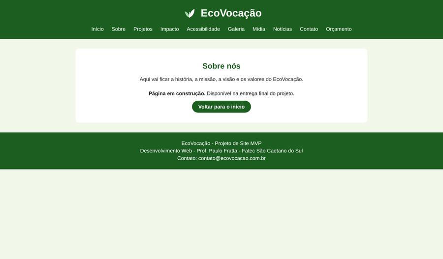
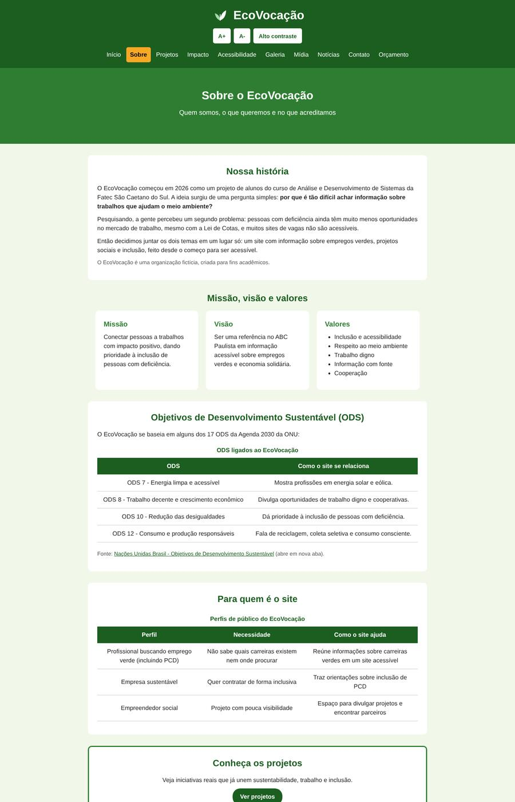
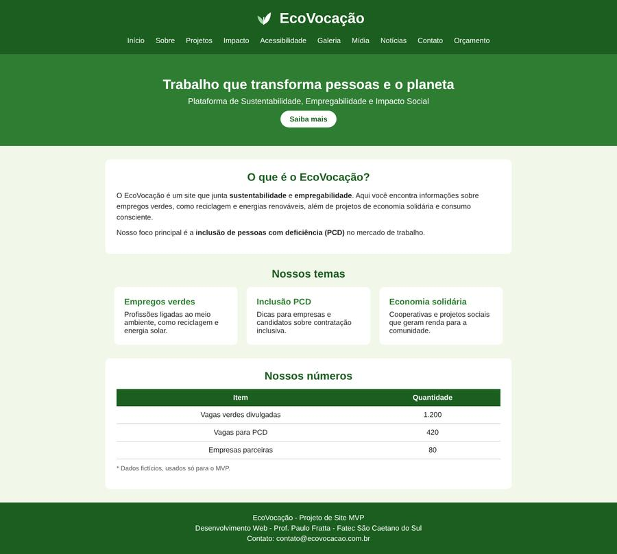
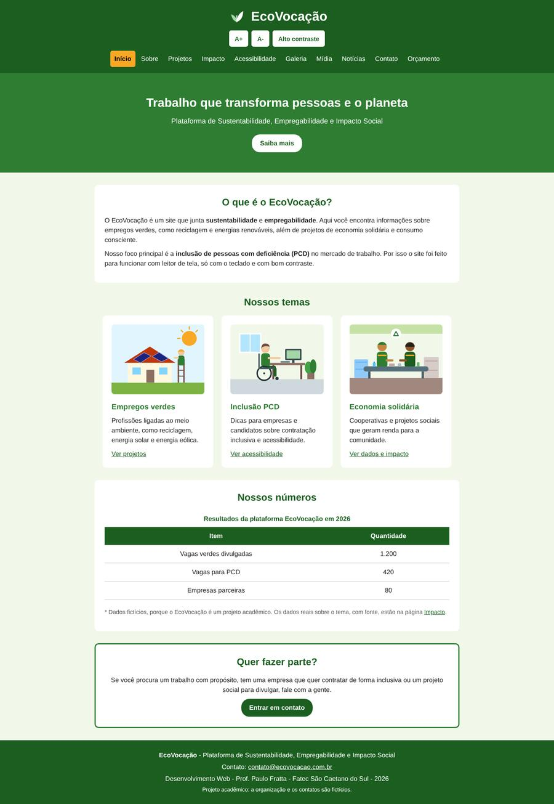

# Relatório de melhorias - do MVP (A05) ao site final (A06)

## 1. Antes e depois

| Aspecto | MVP (A05) | Site final (A06) |
|---|---|---|
| Páginas | Só a index pronta; 9 páginas "em construção" | 10 páginas completas |
| Formulário | Planejado no escopo | `contato.html` com required, email, tel com pattern, date, number, select, radio e checkbox, mais validação em JavaScript |
| Multimídia | Planejada no escopo | Vídeo com poster e legendas, podcast com transcrição, YouTube e mapa em iframe |
| Imagens | Só o logo | 8 ilustrações autorais em SVG, todas com alt e legenda com fonte |
| Dados | Tabela com números fictícios | 3 tabelas com dados reais e fontes na página Impacto |
| Menu | Não mostrava a página atual | Página atual destacada em amarelo (`aria-current="page"`) |
| Acessibilidade | alt no logo e aria-label no menu | Link "Pular para o conteúdo", foco visível, botões A+ / A- / Alto contraste, legendas, transcrição, `caption` e `scope` nas tabelas |
| Responsividade | Uma media query (600px) | Media queries para celular (600px) e tablet (900px), tabelas com rolagem própria, menu com flexbox |
| Rodapé | Texto simples | Contato com link, aviso de dados fictícios |
| JavaScript | Não tinha | `js/script.js`: acessibilidade com localStorage, validação do formulário, controle do vídeo |
| Documentação | README e escopo | README, plano de contexto, diário, orçamento, testes, este relatório e prints |

## 2. Prints

**Página Sobre - antes (MVP):**

**Página Sobre - depois (final):**

**Página inicial - antes e depois:**

## 3. Mudanças em relação ao escopo da A05

- **JavaScript:** o escopo dizia "só se for necessário". Usamos para acessibilidade (tamanho da letra e contraste), validação do formulário e botões do vídeo.
- **Novas pastas:** `js/` e `midia/`, além de `docs/evidencias/`.
- **Imagens:** o escopo previa imagens autorais ou de bancos gratuitos. Escolhemos só ilustrações autorais em SVG.
- O restante do escopo (10 páginas, público, cores, fonte e hospedagem no Railway) continua igual.
